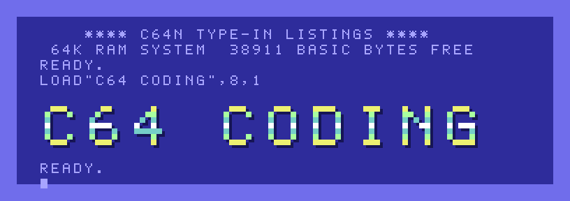

<p align="center">
  <a href="https://c64n.blogspot.com"></a>
</p>

<p align="center">
  <a href="https://c64n.blogspot.com"><b>SITE</b></a> &nbsp;·&nbsp;
  <a href="https://c64n.blogspot.com/p/the-lab.html"><b>THE LAB</b></a> &nbsp;·&nbsp;
  <a href="listings"><b>LISTINGS</b></a> &nbsp;·&nbsp;
  <a href="https://www.youtube.com/channel/UCuvcLWOjYxBfJlriPt3Ww1A"><b>YOUTUBE</b></a> &nbsp;·&nbsp;
  <a href="https://ko-fi.com/c64coding"><b>KO-FI</b></a> &nbsp;·&nbsp;
  <a href="https://github.com/c64n/c64-coding/issues/new/choose"><b>REPORT A MISPRINT</b></a>
</p>

---

## READY.

Original type-in programs for the Commodore 64, in the spirit of the 1980s listings: short, readable BASIC V2 you can type in one sitting. Every program is written in a modern editor, checked line by line, turned into a real `.prg` and run in VICE before it is published on **[c64n.blogspot.com](https://c64n.blogspot.com)** with a full explanation.

This repository holds everything behind the site: the listings, the ready-to-run programs, the lab that tests them, and the Blogger theme.

## LOAD"$",8

```
0 "C64 CODING      " CN 2A
7    "ZARIA"            PRG
4    "BALL"             PRG
7    "QUADRATIC"        PRG
12   "CLOCK"            PRG
634 BLOCKS FREE.
READY.
```

| Blocks | Program | What it does | Category | Article |
|---:|---|---|---|---|
| 7 | [ZARIA](listings/zaria) | Three dice that tumble, rattle and land; calls doubles and triples | Games | [read](https://c64n.blogspot.com/2026/11/zaria-three-dice-on-commodore-64.html) |
| 4 | [BALL](listings/ball) | A ball bouncing round the screen: new colour, a SID note and a count on every bounce | Graphics | [read](https://c64n.blogspot.com/2026/11/the-bouncing-ball-animation-with-poke.html) |
| 7 | [QUADRATIC](listings/quadratic) | Solves ax²+bx+c=0 (real, double, complex or linear) and checks the answer | Maths | [read](https://c64n.blogspot.com/2026/11/quadratic-equations.html) |
| 12 | [CLOCK](listings/clock) | A digital clock with big digits, a blinking colon and an alarm | Utilities | [read](https://c64n.blogspot.com/2026/11/digital-clock.html) |

## RUN

**In an emulator.** Open a listing folder, download the `.prg` and drag it onto a [VICE](https://vice-emu.sourceforge.io/) window. It loads and runs on its own.

**By hand.** Type the `.bas` file into a real C64 or an emulator. Type every letter **without SHIFT**: the files are stored in lower case, which is how the C64 sees ordinary capitals. On the site you can tick off each line as you type it.

## The lab

`lab/` is the bench every listing goes through: VS Code for editing, a Python checker, `petcat` to tokenize, and VICE to run.

```
.bas  ──►  c64.py  ──►  petcat -w2  ──►  .prg  ──►  x64sc
           checks        tokenizes        $0801       runs
```

1. Install [VICE](https://vice-emu.sourceforge.io/) (tested with 3.10) and Python 3.9+.
2. Open the `lab` folder in VS Code.
3. If VICE is not in `D:\GTK3VICE-3.10-win64\bin`, edit `VICE_BIN` in `run-c64.bat` and `watch-c64.bat`.
4. Open `programs\HELLO.bas` and press `Ctrl+Shift+B`.

What it checks, how run-on-save works and how PETSCII case is handled: [The Lab](https://c64n.blogspot.com/p/the-lab.html) and [`lab/README.md`](lab/README.md). Tests: `python -m unittest discover lab/tests`.

## LIST

```
lab/          the bench: VS Code tasks, c64.py, watcher, syntax colours
listings/     one folder per published listing: .bas, .prg, screenshot, notes
blogger/      the site: theme, page and post sources
assets/       logo, banner and social image (make_assets.py redraws them)
```

## ?MISPRINT ERROR

Found a typo in a listing, or a program that does not run? [Open a misprint report](https://github.com/c64n/c64-coding/issues/new?template=misprint.yml). How a listing is added: [CONTRIBUTING.md](CONTRIBUTING.md).

## License

By Vasileios Dionysopoulos.

- **Code** (the listings in `listings/`, the lab in `lab/`, the Blogger theme and the scripts in `assets/`): [MIT](LICENSE). Type them in, change them, use them in your own programs; keep the copyright line.
- **Articles, screenshots, recordings and artwork** (`blogger/posts/`, `blogger/pages/`, the images and videos in `listings/` and `assets/`): [CC BY 4.0](https://creativecommons.org/licenses/by/4.0/). Share and adapt them, with credit to *C64 Coding* and a link to [c64n.blogspot.com](https://c64n.blogspot.com).

Commodore 64 is a trademark of its respective owner; this is a fan project with no affiliation.
