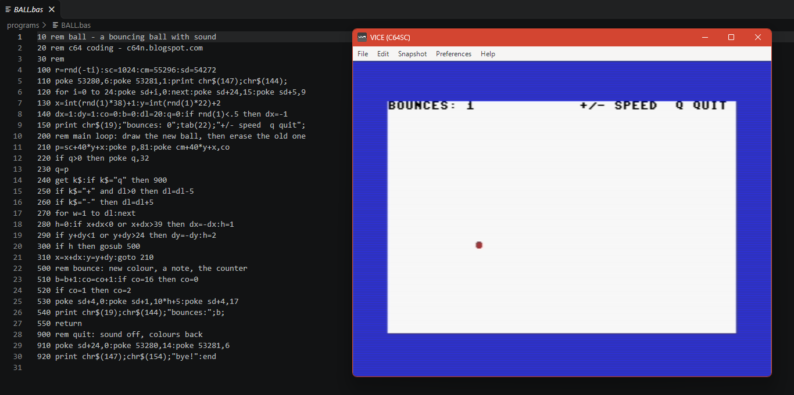

# C64 BASIC V2 IDE for Windows + VS Code

This ZIP is a new folder-based starter. Requires VICE 3.10 and Python 3.9+; no pip packages.

## Install
1. Extract to `D:\c64-ide-v2` (or any directory). **Do not overwrite your existing `D:\c64-starter`** before testing.
2. Check that VICE binaries are at `D:\GTK3VICE-3.10-win64\bin`. If not, change `VICE_BIN` in both BAT files.
3. VS Code: File > Open Folder > `D:\c64-ide-v2`. Trust only if you trust the project.
4. Open `programs\HELLO.bas`, press `Ctrl+S`, then `Ctrl+Shift+B` to build/run.
5. Automatic Run on Save: VS Code `Ctrl+Shift+P` > **Tasks: Manage Automatic Tasks in Folder** > **Allow Automatic Tasks in Folder**; reopen folder. VS Code launches a background watcher. Each **subsequent** save of any `.bas` in `programs\` builds and launches it. You can also start **Terminal > Run Task > C64: Run on Save** manually. Stop task to disable. **Do not run watcher and Ctrl+Shift+B together** or two VICE instances may launch.

## Syntax highlighting
This contains a small offline, source-form VS Code extension in `vscode-extension/`.
To use it without downloading anything, open `vscode-extension/` in a **separate** VS Code window, press **F5** (Run Extension), then open your main C64 folder in that *Extension Development Host* window. Syntax highlighting works in that window. No VSIX build tools are required. For persistent installation, use `vsce` (requires Node.js) to package this extension into a VSIX, or choose a compatible Commodore BASIC extension from VS Code Marketplace. The folder's `settings.json` already associates `.bas` with language `c64basic` after the extension loads.

## What happens when you build
The Python preprocessor validates line numbers, duplicates, encoding, unmatched quotes and warns on `CLS`/`CLEAR`. It writes a temporary lower-case ASCII PETCAT source, then calls PETCAT `-w2` and checks the PRG header and the first BASIC token before launching VICE. The **original `.bas` stays unchanged**.

**Important PETSCII behavior**: PETCAT's lower-case ASCII convention means uppercase source quoted text also becomes lower-case in the intermediate file, to display uppercase letters on the C64's default character set. This preserves the intended **visible uppercase text**, but it is NOT a general lossless conversion of mixed-case text or PETSCII control codes. For intentionally mixed-case screen text or special PETSCII symbols, use explicit `CHR$`, charset switching, or PETCAT escape conventions and test the resulting PRG. Non-ASCII Unicode/Greek source letters produce a diagnostic.

### Diagnostics
Build output uses `path(line): error: description`, shown in VS Code Problems. A failed build deletes the old PRG so stale programs cannot be launched. Note that arbitrary BASIC runtime errors (e.g. undefined variable, invalid screen coordinates) occur in the emulator, not at build time.

### File layout
- `programs/*.bas`: numbered BASIC listings; `*.prg`: output next to each listing
- `.build/*.petcat.txt`: generated intermediate PETCAT input
- `tools/c64.py`: validation, normalization, conversion, watcher and launcher
- `run-c64.bat`: manual build + run
- `watch-c64.bat`: background run-on-save task
- `.vscode/tasks.json`: two VS Code tasks
- `vscode-extension/`: optional offline syntax highlighting extension

### Troubleshooting
- Check PETCAT/VICE locations in BAT files.
- Verify Python with `py -3 --version`, or `python --version`.
- To inspect PRG: `& "D:\GTK3VICE-3.10-win64\bin\petcat.exe" -2 -- "D:\c64-ide-v2\programs\HELLO.prg"`.
- Multiple saves open multiple emulator windows; close earlier windows when done.
- Automatic task first requires VS Code permission; background process only watches the `programs` folder.
