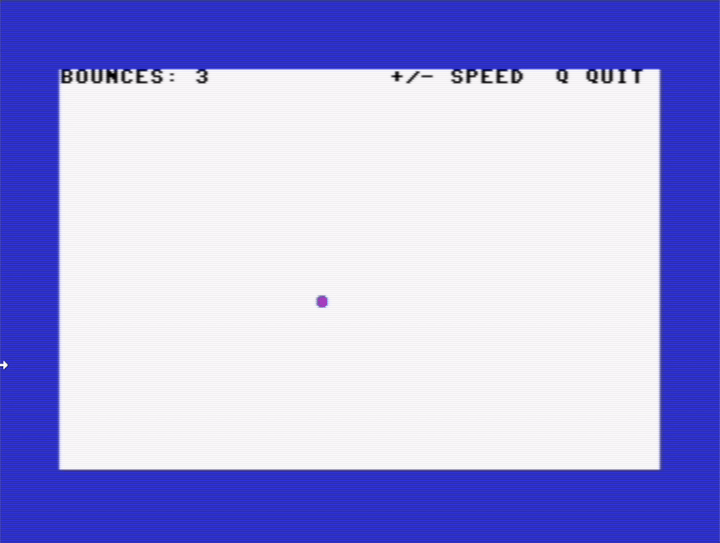

# BALL

A ball bouncing round the screen, drawn straight into screen memory with `POKE`. Every bounce changes its colour, plays a note on the SID and adds one to the counter. <kbd>+</kbd> and <kbd>-</kbd> change the speed.

| | |
|---|---|
| Category | Graphics |
| Language | Commodore BASIC V2 |
| Length | 30 lines, 4 blocks (956 bytes) |
| Keys | <kbd>+</kbd> faster, <kbd>-</kbd> slower, <kbd>Q</kbd> quits |
| Special keys | None |
| Video | [YouTube](https://youtu.be/wRbRXAkrrSI) |
| Article | [The Bouncing Ball: Animation with POKE](https://c64n.blogspot.com/2026/11/the-bouncing-ball-animation-with-poke.html) |

## Files

- [`BALL.bas`](BALL.bas) – the listing. Type every letter without SHIFT.
- [`BALL.prg`](BALL.prg) – ready to run: drag it onto a VICE window.
- [`ball.gif`](ball.gif), [`ball-demo.mp4`](ball-demo.mp4) – recorded in VICE, with sound in the MP4.
- [`ball-run.png`](ball-run.png), [`ball-lab.png`](ball-lab.png) – screenshots from VICE and the lab.

## How it is built

| Lines | Block |
|---|---|
| 100–150 | Setup: addresses, colours, SID, a random start, the status line |
| 200–310 | Main loop: draw the new ball, erase the old one, read the keys, wait, bounce, move |
| 500–550 | Subroutine: on a bounce, new colour, a note (higher for top and bottom), counter |
| 900–920 | Quit: sound off, colours back |

The ball is drawn at its new position *before* the old one is erased, so there is never a frame with no ball on the screen and it does not flicker.
