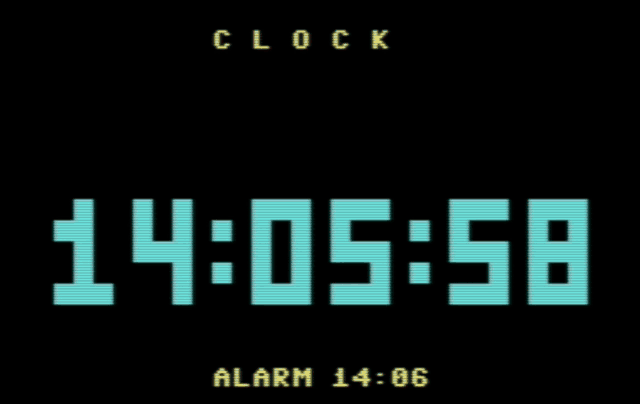

# CLOCK

A digital clock for the Commodore 64: big digits made of reverse-video blocks, a colon that blinks every second, and an alarm that beeps and flashes until you press a key. The time itself comes from `TI$`, the clock the C64 keeps by itself.

| | |
|---|---|
| Category | Utilities |
| Language | Commodore BASIC V2 |
| Length | 74 lines, 13 blocks (3,153 bytes) |
| Keys | Digits, INST/DEL and RETURN to set it; <kbd>Y</kbd>/<kbd>N</kbd> for the alarm; any key stops the alarm; <kbd>Q</kbd> quits |
| Special keys | None |
| Video | [YouTube](https://youtu.be/hmrGro6zp3A) |
| Article | [CLOCK: A Digital Clock with Big Digits and an Alarm](https://c64n.blogspot.com/2026/11/digital-clock.html) |

## Files

- [`CLOCK.bas`](CLOCK.bas) – the listing, with a remark on most lines. Type every letter without SHIFT; the remarks after `:rem` can be left out.
- [`CLOCK.prg`](CLOCK.prg) – ready to run: drag it onto a VICE window.
- [`clock.gif`](clock.gif), [`clock-demo.mp4`](clock-demo.mp4) – recorded in VICE, with sound in the MP4.
- [`clock-setup.png`](clock-setup.png), [`clock-run.png`](clock-run.png), [`clock-alarm.png`](clock-alarm.png), [`clock-lab.png`](clock-lab.png) – screenshots from VICE and the lab.

## How it is built

| Lines | Block |
|---|---|
| 100–190 | Setup: colours, control codes, the SID, the digit positions |
| 200–320 | Ask for the time and the alarm, then set `TI$` |
| 400–450 | Draw the clock screen |
| 500–610 | Main loop: wait for a new second, redraw only the digits that changed, blink, check the alarm |
| 620–660 | Subroutines: ring the alarm, stop it |
| 700–790 | Subroutine, run once: build the ten 3×5 digits as strings |
| 800–810 | Subroutine: a number as two digits (`RIGHT$(STR$(V+100),2)`) |
| 850–885 | Subroutine: read a number with `GET`: digits only, two at most, DEL and RETURN |
| 900–920 | Quit: sound off, colours back |
