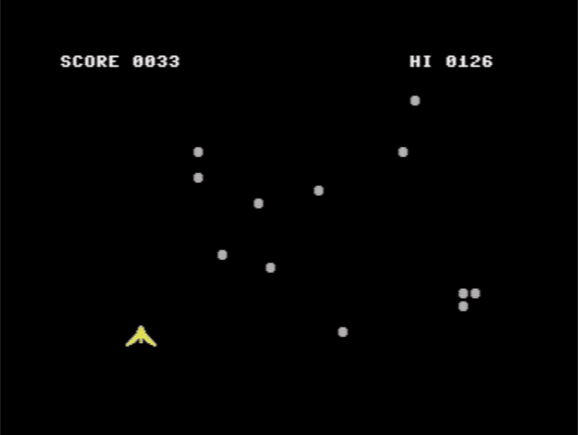

# DODGE

A small game in 6502 assembly: steer a ship along the bottom of the screen and dodge the rocks that fall faster and faster. The VIC-II's own sprite-to-background collision register decides when you are hit.



| | |
|---|---|
| Category | Games |
| Language | 6502 assembly (64tass) |
| Size | 938 bytes, 4 blocks (`dodge.prg`) |
| Video | [YouTube](https://youtu.be/oTj93XUV34o) |
| Article | [DODGE: A Game in 6502 Assembly](https://c64n.blogspot.com/2026/11/dodge.html) |
| Controls | Joystick in port 2, or <kbd>Z</kbd> / <kbd>X</kbd>; fire or <kbd>SPACE</kbd> to start; <kbd>Q</kbd> on the title screen to quit |

## Files

- [`dodge.asm`](dodge.asm) – the source, with comments.
- [`dodge.prg`](dodge.prg) – ready to run: drag it onto a VICE window. It starts with a BASIC line, `10 SYS 2061`.
- [`DODGE.bas`](DODGE.bas) – the type-in version: a BASIC loader with the machine code as `DATA`, 12 numbers and a checksum per line. It puts the code at 49152 and runs it with `SYS 49152`.
- [`make_loader.py`](make_loader.py) – builds `DODGE.bas` from the assembled code.
- [`dodge.gif`](dodge.gif), [`dodge-demo.mp4`](dodge-demo.mp4) – recorded in VICE.
- [`dodge-title.png`](dodge-title.png), [`dodge-play.png`](dodge-play.png), [`dodge-over.png`](dodge-over.png), [`dodge-lab.png`](dodge-lab.png), [`dodge-loader-lab.png`](dodge-loader-lab.png) – screenshots.

## Build

```
64tass -C -a -i dodge.asm -o dodge.prg
64tass -C -a -i -D LOADER=1 dodge.asm -o dodge-c000.prg
python make_loader.py dodge-c000.prg DODGE.bas
```

In the lab, open `dodge.asm` and press `Ctrl+Shift+B` (needs `64tass.exe` in `lab/tools`).
