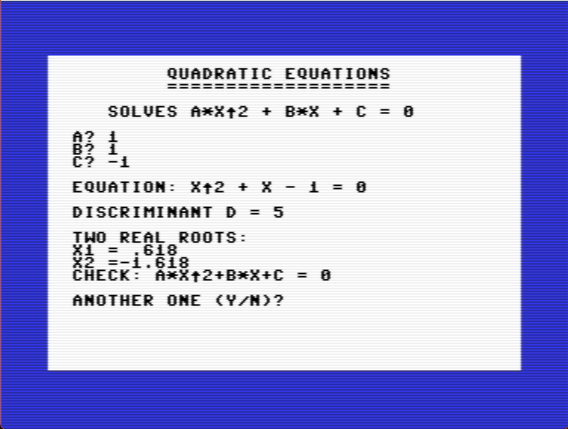
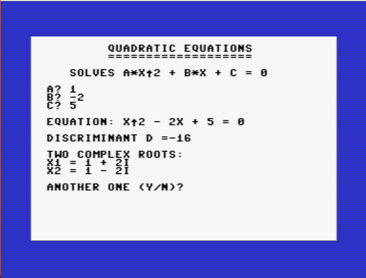
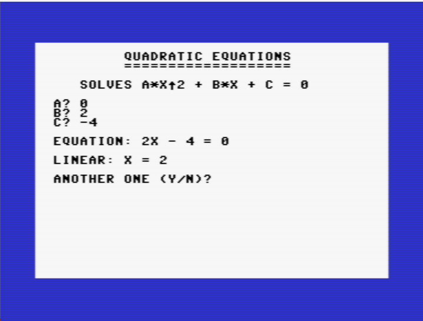

# QUADRATIC

Solves a·x² + b·x + c = 0 on the Commodore 64. It prints the equation as you would write it, the discriminant, and the roots: two real, one double, or two complex. Real roots are checked by putting them back into the equation. If a is 0 it solves the linear equation instead.

| Real roots | Complex roots | a = 0 |
|---|---|---|
|  |  |  |

| | |
|---|---|
| Category | Maths |
| Language | Commodore BASIC V2 |
| Length | 64 lines, 7 blocks (1,551 bytes) |
| Keys | Type a, b and c, each followed by RETURN; <kbd>Y</kbd> for another equation |
| Special keys | None |
| Video | [YouTube](https://youtu.be/Xx1kqtxLHrw) |
| Article | [Quadratic Equations: Solving ax²+bx+c=0 in BASIC](https://c64n.blogspot.com/2026/11/quadratic-equations.html) |

## Files

- [`QUADRATIC.bas`](QUADRATIC.bas) – the listing. Type every letter without SHIFT.
- [`QUADRATIC.prg`](QUADRATIC.prg) – ready to run: drag it onto a VICE window.
- [`quadratic-demo.mp4`](quadratic-demo.mp4) – three equations solved in VICE.
- [`quadratic-real.png`](quadratic-real.png), [`quadratic-complex.png`](quadratic-complex.png), [`quadratic-linear.png`](quadratic-linear.png), [`quadratic-lab.png`](quadratic-lab.png) – screenshots from VICE and the lab.

## How it is built

| Lines | Block |
|---|---|
| 100–190 | Setup, a rounding function (`DEF FN R`), input of a, b, c |
| 200–340 | Build the equation as text, compute the discriminant, choose a case |
| 400–480 | a = 0: linear, every x, or no solution; then "another one?" |
| 500–550 | Two real roots |
| 600–640 | One double root |
| 700–750 | Two complex roots |
| 800–870 | Subroutine: add one term to the equation text |
| 900–920 | Subroutine: check a root by substitution |

## Tested cases

| a | b | c | Result |
|---:|---:|---:|---|
| 1 | -5 | 6 | x1 = 3, x2 = 2 |
| 1 | -4 | 4 | double root x = 2 |
| 1 | -2 | 5 | x = 1 ± 2i |
| 0 | 2 | -4 | linear: x = 2 |
| 0 | 0 | 0 | every x is a solution |
| 0 | 0 | 5 | no solution |
| 2 | 3 | -2 | x1 = 0.5, x2 = -2 |
| 1 | 0 | -4 | x1 = 2, x2 = -2 |
