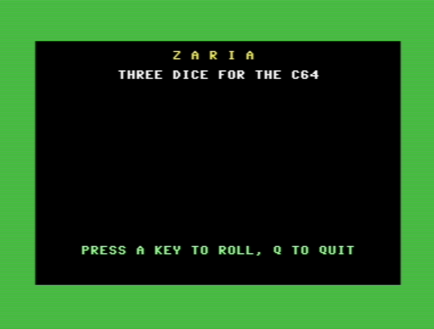
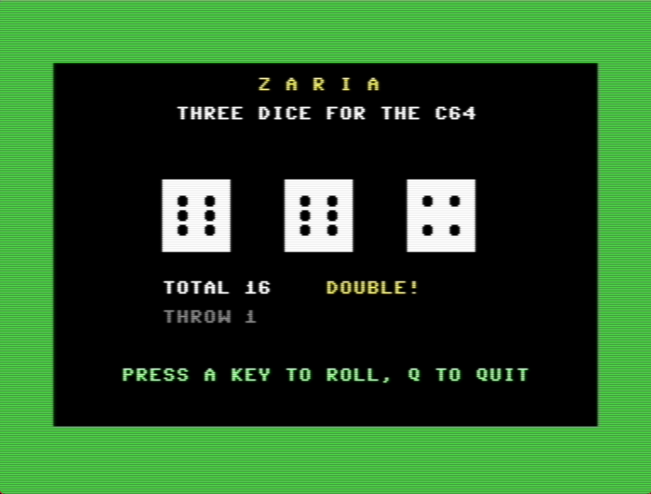

# ZARIA

Three dice for the Commodore 64. Press a key and the dice tumble, slowing down with a rattle from the SID, then land and show the total. Doubles and triples are called out. *Zaria* is Greek for dice.

| Title screen | A roll |
|---|---|
|  |  |

| | |
|---|---|
| Category | Games |
| Language | Commodore BASIC V2 |
| Length | 49 lines, 7 blocks (1,615 bytes) |
| Keys | Any key rolls, <kbd>Q</kbd> quits |
| Special keys | None, everything is typed as `CHR$()` |
| Video | [YouTube](https://youtu.be/lFGR9E6wPSw) |
| Article | [ZARIA: Three Dice on the Commodore 64](https://c64n.blogspot.com/2026/11/zaria-three-dice-on-commodore-64.html) |

## Files

- [`ZARIA.bas`](ZARIA.bas) – the listing. Type every letter without SHIFT.
- [`ZARIA.prg`](ZARIA.prg) – ready to run: drag it onto a VICE window.
- [`zaria.gif`](zaria.gif), [`zaria-demo.mp4`](zaria-demo.mp4) – recorded in VICE, with sound in the MP4.
- [`zaria-title.png`](zaria-title.png), [`zaria-roll.png`](zaria-roll.png), [`zaria-lab.png`](zaria-lab.png) – screenshots from VICE and the lab.

## How it is built

| Lines | Block |
|---|---|
| 100–180 | Setup: seed, colours, SID voice 1 for noise, dice faces as `DATA` |
| 200–250 | Title and prompt |
| 300–390 | Wait for a key, then eight quick throws that slow down, each with a click |
| 400–470 | Total, doubles and triples, throw counter |
| 500–510 | Subroutine: draw one die with a single `PRINT` |
| 600–670 | Subroutine, run once: build each die as one string of reverse-video rows joined by cursor moves |
| 900–920 | Quit: sound off, colours back |

Every die is drawn at a fixed position with `CHR$(19)` (home) and a string of cursor-down codes, so each throw replaces the last one and the screen never scrolls.
